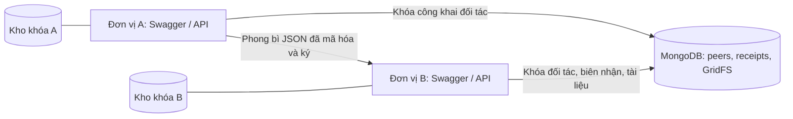
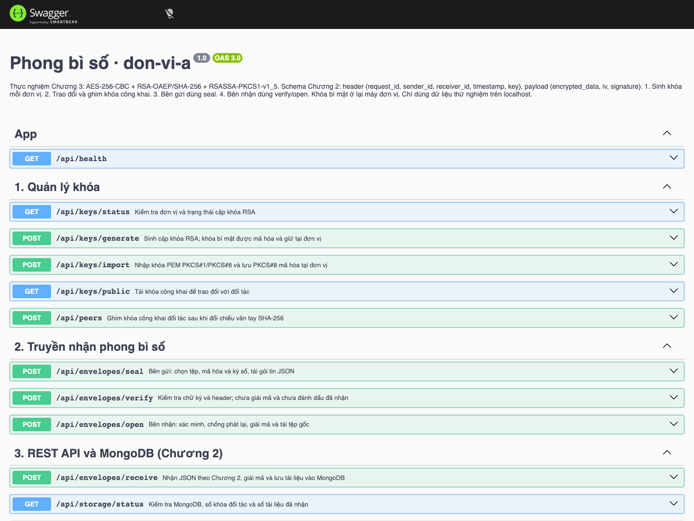

# PTIT Secure Envelope

**Hệ thống truyền nhận gói tin bảo mật giữa các đơn vị ứng dụng ký số và mã hóa dữ liệu.**

Dự án thực nghiệm sử dụng **NestJS, TypeScript, Node.js và MongoDB**, phục vụ bài tập lớn về mật mã học. Hai đơn vị A/B chạy máy chủ riêng, giữ khóa bí mật tại đơn vị mình, trao đổi phong bì JSON qua HTTP và lưu tài liệu đã nhận bằng GridFS. Đặc tả gói tin theo cấu trúc `header`/`payload` trong Chương 2 của báo cáo.

Giao diện thao tác là **Swagger UI**, hỗ trợ sinh/nhập khóa, ghim khóa công khai, chọn tệp để mã hóa và ký số, xác minh, giải mã và tải tài liệu.

## Mục lục

- [Chức năng và công nghệ](#chức-năng-và-công-nghệ)
- [Kiến trúc và luồng xử lý](#kiến-trúc-và-luồng-xử-lý)
- [Yêu cầu môi trường](#yêu-cầu-môi-trường)
- [Chạy nhanh bằng Docker](#chạy-nhanh-bằng-docker)
- [Chạy bằng Node.js](#chạy-bằng-nodejs)
- [Cấu hình môi trường](#cấu-hình-môi-trường)
- [Sử dụng Swagger](#sử-dụng-swagger)
- [Danh sách API](#danh-sách-api)
- [Ví dụ cURL](#ví-dụ-curl)
- [Định dạng phong bì JSON](#định-dạng-phong-bì-json)
- [Kiểm thử, demo và báo cáo](#kiểm-thử-demo-và-báo-cáo)
- [Cấu trúc thư mục](#cấu-trúc-thư-mục)
- [Vận hành và dữ liệu](#vận-hành-và-dữ-liệu)
- [Xử lý lỗi thường gặp](#xử-lý-lỗi-thường-gặp)
- [Phạm vi và giới hạn](#phạm-vi-và-giới-hạn)
- [Tài liệu tham khảo](#tài-liệu-tham-khảo)

## Chức năng và công nghệ

- Sinh hoặc nhập cặp khóa RSA; bảo vệ khóa bí mật bằng PKCS#8 mã hóa với mật khẩu.
- Ghim khóa công khai đối tác sau khi đối chiếu vân tay SHA-256.
- Mã hóa tệp bằng AES-256-CBC, bọc khóa phiên bằng RSA-OAEP và ký bản mã.
- Xác minh chữ ký trước giải mã; đối chiếu dữ liệu điều khiển, kích thước và SHA-256 sau giải mã.
- Chống phát lại bằng UUID, cửa sổ thời gian và chỉ mục duy nhất trong MongoDB.
- Lưu tệp vào GridFS, trả biên nhận và cho phép tải lại tài liệu.

| Thành phần       | Công nghệ / tham số                               |
| ---------------- | ------------------------------------------------- |
| Máy chủ          | Node.js 22, NestJS 11                             |
| Ngôn ngữ         | TypeScript 5.9, bật `strict`                      |
| Thư viện mật mã  | `node:crypto`, sử dụng OpenSSL                    |
| Mã hóa tệp       | AES-256-CBC, khóa 32 byte, IV 16 byte, đệm PKCS#7 |
| Bọc khóa phiên   | RSA-OAEP, SHA-256 và MGF1/SHA-256                 |
| Ký số            | RSASSA-PKCS1-v1_5 với SHA-256                     |
| Khóa RSA         | Hỗ trợ 2048, 3072 hoặc 4096 bit                   |
| Lưu trữ          | MongoDB 8, MongoDB Node.js Driver, GridFS         |
| API / tải tệp    | REST/JSON, Multer, Swagger/OpenAPI                |
| Kiểm tra đầu vào | `class-validator`, `class-transformer`            |
| Kiểm thử         | `node:test`, `node:assert`, HTTP `fetch`          |
| Báo cáo          | `docx`, Chart.js, Playwright và Google Chrome     |

## Kiến trúc và luồng xử lý



1. A/B tạo cặp khóa riêng, trao đổi khóa công khai và đối chiếu vân tay.
2. A tạo khóa AES/IV ngẫu nhiên, đưa tệp Base64 và metadata vào JSON rồi mã hóa.
3. A bọc khóa AES bằng khóa công khai của B; ký chuỗi Base64 bản mã bằng khóa bí mật của A.
4. B kiểm tra schema, người nhận, thời gian và chữ ký bằng khóa công khai đã ghim của A.
5. B mở khóa AES bằng khóa bí mật của mình, giải mã và kiểm tra `control`, kích thước, SHA-256.
6. B lưu tài liệu vào GridFS và ghi biên nhận có `request_id` duy nhất.

Trong Compose, hai đơn vị dùng chung máy chủ MongoDB; khóa đối tác và biên nhận được phân tách theo `ownerId`. Khóa bí mật nằm trong volume riêng của từng đơn vị.

## Yêu cầu môi trường

| Cách sử dụng              | Yêu cầu                                                                     |
| ------------------------- | --------------------------------------------------------------------------- |
| Chạy toàn bộ bằng Docker  | Docker Desktop hoặc Docker Engine có lệnh `docker compose`, hỗ trợ `--wait` |
| Chạy/phát triển trên host | Node.js 22.12 trở lên trong nhánh 22, npm và MongoDB 8                      |
| Thao tác API              | Trình duyệt truy cập Swagger                                                |
| Chạy ví dụ cURL           | cURL; các lệnh bên dưới dùng Bash/zsh                                       |
| Chụp ảnh báo cáo          | Google Chrome trên host và dependency phát triển qua `npm ci`               |

Kiểm tra bằng `docker version`, `docker compose version`, `node --version`, `npm --version`. Node.js/npm trên host chỉ cần khi chạy các lệnh `npm`.

Trên máy mới, lấy mã nguồn từ repository:

```bash
git clone https://github.com/Duong-Anh-Duc/MMH.git
cd MMH
```

Thực hiện các lệnh tiếp theo tại thư mục gốc chứa `package.json` và `compose.yaml`.

## Chạy nhanh bằng Docker

```bash
docker compose up -d --build --wait
docker compose ps
```

Compose khởi động `mongodb`, `unit-a`, `unit-b`. Hai ứng dụng chờ MongoDB qua healthcheck trước khi chạy.

| Đơn vị | Swagger UI                 | OpenAPI JSON                    | Health                           |
| ------ | -------------------------- | ------------------------------- | -------------------------------- |
| A      | http://127.0.0.1:3000/docs | http://127.0.0.1:3000/docs-json | http://127.0.0.1:3000/api/health |
| B      | http://127.0.0.1:3001/docs | http://127.0.0.1:3001/docs-json | http://127.0.0.1:3001/api/health |

Health của A trả về:

```json
{
  "status": "ok",
  "unitId": "don-vi-a"
}
```

| Dịch vụ | Từ máy host                 | Trong mạng Compose        |
| ------- | --------------------------- | ------------------------- |
| A       | `http://127.0.0.1:3000`     | `http://unit-a:3000`      |
| B       | `http://127.0.0.1:3001`     | `http://unit-b:3000`      |
| MongoDB | `mongodb://127.0.0.1:27018` | `mongodb://mongodb:27017` |

Hai container ứng dụng đều nghe `0.0.0.0:3000` bên trong. Cổng công bố trên host được giới hạn ở `127.0.0.1`; trình duyệt dùng địa chỉ host, chương trình trong container dùng tên dịch vụ Compose.

Image `ptit-secure-envelope:local` được build nhiều giai đoạn, chạy bằng tài khoản `node`. Image cuối chỉ cài dependency cần cho ứng dụng. Công cụ test, Chrome và công cụ xuất báo cáo chạy trên host.

## Chạy bằng Node.js

Nếu đang chạy bản Docker trên cổng 3000/3001, dừng hai container ứng dụng trước khi chạy bản host:

```bash
docker compose stop unit-a unit-b
docker compose up -d --wait mongodb
npm ci
npm run build
```

### macOS / Linux

Terminal 1 — đơn vị A:

```bash
UNIT_ID=don-vi-a HOST=127.0.0.1 PORT=3000 DATA_DIR=./data/don-vi-a npm start
```

Terminal 2 — đơn vị B:

```bash
UNIT_ID=don-vi-b HOST=127.0.0.1 PORT=3001 DATA_DIR=./data/don-vi-b npm start
```

### Windows PowerShell

Terminal 1 — đơn vị A:

```powershell
$env:UNIT_ID = 'don-vi-a'
$env:HOST = '127.0.0.1'
$env:PORT = '3000'
$env:DATA_DIR = './data/don-vi-a'
npm start
```

Terminal 2 — đơn vị B:

```powershell
$env:UNIT_ID = 'don-vi-b'
$env:HOST = '127.0.0.1'
$env:PORT = '3001'
$env:DATA_DIR = './data/don-vi-b'
npm start
```

Mở Swagger theo các URL ở trên. Mỗi đơn vị phải có `UNIT_ID` và `DATA_DIR` riêng. Khi phát triển, thay `npm start` bằng `npm run start:dev` để tự khởi động lại khi sửa TypeScript.

Bản host mặc định dùng DB `ptit_envelope` và thư mục `data/`; bản Docker dùng DB `ptit_envelope_docker` và named volume. Khi chuyển cách chạy, khởi tạo/ghim khóa trong đúng môi trường đang dùng.

## Cấu hình môi trường

Tệp mẫu: [`.env.example`](.env.example). Nếu chưa có `.env`, sao chép tệp mẫu rồi chỉnh các giá trị cần dùng:

```bash
cp .env.example .env
```

PowerShell dùng `Copy-Item .env.example .env`. `.env` chứa cấu hình cục bộ, đã được loại khỏi Git và Docker build context.

### Chạy trực tiếp bằng Node.js

`npm start` và `npm run start:dev` đọc `.env`. Biến được đặt sẵn trong môi trường terminal được ưu tiên hơn giá trị cùng tên trong tệp.

| Biến                       | Mặc định                    | Ý nghĩa                                                         |
| -------------------------- | --------------------------- | --------------------------------------------------------------- |
| `UNIT_ID`                  | `don-vi-a`                  | Mã đơn vị, 1–64 ký tự chữ/số, `_`, `-`                          |
| `HOST`                     | `127.0.0.1`                 | Địa chỉ lắng nghe                                               |
| `PORT`                     | `3000`                      | Cổng HTTP                                                       |
| `DATA_DIR`                 | `data/<UNIT_ID>`            | Thư mục khóa của đơn vị                                         |
| `MONGODB_URI`              | `mongodb://127.0.0.1:27018` | Chuỗi kết nối MongoDB                                           |
| `MONGODB_DATABASE`         | `ptit_envelope`             | Tên DB ứng dụng                                                 |
| `MAX_FILE_SIZE_MB`         | `10`                        | Giới hạn tệp gốc theo MiB, hỗ trợ 1–100                         |
| `TIMESTAMP_WINDOW_SECONDS` | `300`                       | Độ lệch thời gian ở cả quá khứ và tương lai, hỗ trợ 1–3600 giây |
| `RECEIVE_KEY_PASSPHRASE`   | Chưa đặt                    | Mật khẩu khóa của chính đơn vị nhận, dùng cho `receive`         |

Khi chạy hai terminal, đặt mật khẩu nhận riêng cho từng tiến trình nếu cả A/B cùng nhận JSON tự động.

### Chạy bằng Docker Compose

| Biến trong môi trường / `.env`  | Mặc định               | Ý nghĩa                             |
| ------------------------------- | ---------------------- | ----------------------------------- |
| `UNIT_A_PORT`                   | `3000`                 | Cổng host của A                     |
| `UNIT_B_PORT`                   | `3001`                 | Cổng host của B                     |
| `MONGO_PORT`                    | `27018`                | Cổng MongoDB trên host              |
| `DOCKER_MONGODB_DATABASE`       | `ptit_envelope_docker` | DB dùng cho hai đơn vị trong Docker |
| `UNIT_A_RECEIVE_KEY_PASSPHRASE` | Chưa đặt               | Mật khẩu khóa A khi A nhận JSON     |
| `UNIT_B_RECEIVE_KEY_PASSPHRASE` | Chưa đặt               | Mật khẩu khóa B khi B nhận JSON     |

Trong container, `HOST`, `PORT`, `DATA_DIR`, `MONGODB_URI`, giới hạn tệp và cửa sổ thời gian được đặt trực tiếp trong [compose.yaml](compose.yaml). Muốn đổi các giá trị này cho Docker, chỉnh `x-unit.environment`; các biến tương ứng trong `.env` dành cho bản host không ghi đè cấu hình đó.

Để B nhận JSON, đặt `UNIT_B_RECEIVE_KEY_PASSPHRASE` trong `.env` bằng **đúng mật khẩu đã dùng lúc sinh khóa B**, rồi áp dụng:

```bash
docker compose up -d --wait unit-b
```

## Sử dụng Swagger

### 1. Sinh hoặc nhập khóa

Trên Swagger của mỗi bên, chọn `POST /api/keys/generate` → **Try it out**. Nhập `passphrase` riêng, dài **12–128 ký tự**, và `modulusLength` là `2048`, `3072` hoặc `4096`.

HTTP 201 trả `unitId`, `publicKeyPem`, `fingerprint`. Lưu mật khẩu để dùng lại; khóa bí mật được mã hóa và lưu tại đơn vị. Dùng `GET /api/keys/status` kiểm tra khóa đã có.

Nếu đã có khóa PEM, dùng `POST /api/keys/import` với `privateKeyPem`, `passphrase` để nhập khóa của chính đơn vị thay vì sinh mới.

### 2. Trao đổi và ghim khóa công khai

Lấy khóa từ kết quả sinh khóa hoặc `GET /api/keys/public`. Đối chiếu vân tay SHA-256 qua kênh độc lập.

Tại A, gọi `POST /api/peers` với thông tin của B; tại B, thực hiện tương tự với thông tin của A:

| Trường                | Nội dung                                      |
| --------------------- | --------------------------------------------- |
| `unitId`              | Mã đơn vị đối tác                             |
| `publicKeyPem`        | Toàn bộ khóa công khai PEM của đối tác        |
| `expectedFingerprint` | Vân tay đã đối chiếu, 64 ký tự hex chữ thường |

### 3. Đóng gói và gửi từ A

Tại A, mở `POST /api/envelopes/seal`, chọn **Try it out**:

| Trường        | Nội dung                                          |
| ------------- | ------------------------------------------------- |
| `file`        | Chọn tệp trong `assets/samples/` hoặc tệp cần thử |
| `recipientId` | `don-vi-b`                                        |
| `passphrase`  | Mật khẩu khóa A                                   |
| `subject`     | Trích yếu tùy chọn, tối đa 500 ký tự              |

Bấm **Execute**, tải JSON phản hồi bằng **Download file**, ví dụ đặt tên `envelope.json`. Nếu dùng tên `package.json` theo đề cương, lưu ngoài thư mục gốc để tránh ghi đè cấu hình npm.

### 4. Xác minh và nhận tại B

- `POST /api/envelopes/verify`: tải lên phong bì để kiểm tra chữ ký và điều kiện tiếp nhận ban đầu.
- `POST /api/envelopes/open`: tải lên phong bì, nhập mật khẩu khóa **B**, bấm **Execute**, tải tệp gốc bằng **Download file**.
- `POST /api/envelopes/receive`: gửi JSON làm toàn bộ request body; B lấy mật khẩu từ cấu hình và trả biên nhận/đường dẫn tải.

**Mỗi phong bì chỉ được nhận thành công một lần.** `verify` chưa tiêu thụ UUID; `open` và `receive` đều ghi nhận đã nhận. Nếu đã thử một cách nhận, tạo phong bì mới trước khi thử cách còn lại. Gói phải còn trong cửa sổ ±300 giây theo cấu hình mặc định.

<details>
<summary>Xem Swagger chạy bằng Docker</summary>



</details>

## Danh sách API

Base URL mặc định: A `http://127.0.0.1:3000`, B `http://127.0.0.1:3001`.

| Method | Endpoint                 | Đầu vào chính                                              | Thành công                               |
| ------ | ------------------------ | ---------------------------------------------------------- | ---------------------------------------- |
| `GET`  | `/api/health`            | —                                                          | `200`: trạng thái, mã đơn vị             |
| `GET`  | `/api/keys/status`       | —                                                          | `200`: trạng thái khóa, vân tay nếu có   |
| `POST` | `/api/keys/generate`     | JSON: `passphrase`, `modulusLength`                        | `201`: thông tin khóa công khai          |
| `POST` | `/api/keys/import`       | JSON: `privateKeyPem`, `passphrase`                        | `201`: thông tin khóa đã nhập            |
| `GET`  | `/api/keys/public`       | —                                                          | `200`: PEM công khai                     |
| `POST` | `/api/peers`             | JSON: `unitId`, `publicKeyPem`, `expectedFingerprint`      | `201`: khóa đã ghim                      |
| `POST` | `/api/envelopes/seal`    | Multipart: `file`, `recipientId`, `passphrase`, `subject?` | `200`: phong bì JSON                     |
| `POST` | `/api/envelopes/verify`  | Multipart: `file`                                          | `200`: kết quả xác minh ban đầu          |
| `POST` | `/api/envelopes/open`    | Multipart: `file`, `passphrase`                            | `200`: tệp gốc                           |
| `POST` | `/api/envelopes/receive` | JSON: `header`, `payload`                                  | `200`: biên nhận, URL tải                |
| `GET`  | `/api/documents/{id}`    | ID tài liệu                                                | `200`: byte gốc từ GridFS                |
| `GET`  | `/api/storage/status`    | —                                                          | `200`: phiên bản MongoDB, DB, số bản ghi |

Các API JSON dùng `Content-Type: application/json`. API chọn tệp dùng `multipart/form-data`; để Swagger/cURL tự tạo boundary. DTO từ chối trường dư. Swagger ở `/docs`, OpenAPI ở `/docs-json`; `/` chuyển hướng sang Swagger.

`open` trả các header `X-Content-SHA256`, `X-Message-Id`, `X-Verified-Sender`, `X-Document-Id`. Endpoint tải GridFS trả `X-Content-SHA256`.

## Ví dụ cURL

Thực hiện sau khi đã sinh/ghim khóa của cả hai bên. Các tệp được lưu trong `data/manual/`, thuộc thư mục dữ liệu cục bộ đã loại khỏi Git.

### Tạo phong bì tại A

```bash
mkdir -p data/manual
printf 'Mật khẩu khóa A: '
IFS= read -r -s PASSPHRASE_A
printf '\n'

curl --fail-with-body \
  --form 'file=@assets/samples/cong-van.pdf' \
  --form-string 'recipientId=don-vi-b' \
  --form-string "passphrase=$PASSPHRASE_A" \
  --form-string 'subject=Công văn thử nghiệm' \
  http://127.0.0.1:3000/api/envelopes/seal \
  --output data/manual/envelope.json

unset PASSPHRASE_A
```

### Kiểm tra chữ ký tại B

```bash
curl --fail-with-body \
  --form 'file=@data/manual/envelope.json' \
  http://127.0.0.1:3001/api/envelopes/verify
```

Sau đó chọn **một** trong hai cách nhận sau.

### Cách A: nhận JSON

B phải cấu hình mật khẩu nhận tự động theo mục [Cấu hình môi trường](#cấu-hình-môi-trường).

```bash
curl --fail-with-body \
  --header 'Content-Type: application/json' \
  --data-binary @data/manual/envelope.json \
  http://127.0.0.1:3001/api/envelopes/receive
```

Biên nhận gồm `status: "accepted"`, `request_id`, `sender_id`, `receiver_id`, `filename`, `sha256`, `document_id`, `download_url`. Ghép `download_url` vào base URL **của B** để tải tài liệu. `document_id` là 24 ký tự hex, khác UUID `request_id` của phong bì.

### Cách B: nhận bằng tệp phong bì

```bash
printf 'Mật khẩu khóa B: '
IFS= read -r -s PASSPHRASE_B
printf '\n'

curl --fail-with-body \
  --form 'file=@data/manual/envelope.json' \
  --form-string "passphrase=$PASSPHRASE_B" \
  http://127.0.0.1:3001/api/envelopes/open \
  --output data/manual/cong-van-khoi-phuc.pdf

unset PASSPHRASE_B
```

Đối chiếu byte trên macOS/Linux:

```bash
cmp assets/samples/cong-van.pdf data/manual/cong-van-khoi-phuc.pdf
```

`cmp` trả exit code 0 và không in nội dung khi hai tệp trùng khớp.

## Định dạng phong bì JSON

Ví dụ mô tả cấu trúc; `<...>` là ký hiệu thay thế, không phải gói tin để gửi thử:

```json
{
  "header": {
    "request_id": "<UUID v4>",
    "sender_id": "don-vi-a",
    "receiver_id": "don-vi-b",
    "timestamp": "<ISO 8601 UTC>",
    "key": "<Base64 của khóa AES đã bọc RSA-OAEP>"
  },
  "payload": {
    "encrypted_data": "<Base64 của bản mã AES>",
    "iv": "<Base64 của IV 16 byte>",
    "signature": "<Base64 của chữ ký RSA>"
  }
}
```

| Thành phần                 | Ý nghĩa                                                                  |
| -------------------------- | ------------------------------------------------------------------------ |
| `request_id`               | UUID v4 mới cho mỗi phong bì                                             |
| `sender_id`, `receiver_id` | Mã đơn vị gửi/nhận                                                       |
| `timestamp`                | Thời gian UTC, kiểm tra cả quá khứ và tương lai                          |
| `header.key`               | Khóa AES 32 byte đã bọc bằng khóa công khai bên nhận                     |
| `encrypted_data`           | JSON bản rõ đã mã hóa AES-256-CBC rồi chuyển Base64                      |
| `iv`                       | IV ngẫu nhiên 16 byte                                                    |
| `signature`                | Chữ ký của bên gửi trên **byte ASCII của chuỗi Base64 `encrypted_data`** |

JSON bên trong bản mã có `protocol`, `control`, `subject`, `filename`, `mimeType`, `size`, `sha256`, `data`. `protocol` là `PTIT-ENVELOPE-CH2`; `data` là tệp Base64; `control` lưu bản sao header/IV để đối chiếu sau giải mã.

Chữ ký trực tiếp bảo vệ bản mã. Chấp nhận toàn bộ header/IV còn cần bước kiểm tra `control`; `verify` chưa hoàn tất giải mã hoặc ghi nhận đã nhận.

Có **hai lớp Base64**, nên với tệp lớn, dung lượng phong bì tăng xấp xỉ **77,8%**, cộng metadata, padding, khóa bọc và chữ ký. Mức 33,3% chỉ ứng với một lớp Base64.

## Kiểm thử, demo và báo cáo

Các lệnh sau chạy trên host sau `npm ci`. MongoDB phải hoạt động; có thể dùng `docker compose up -d --wait mongodb`. Demo/benchmark đọc `MONGODB_URI` từ môi trường tiến trình, mặc định `mongodb://127.0.0.1:27018`; khi đổi cổng, đặt biến này cho lệnh tương ứng.

| Lệnh                   | Mục đích                                                                          |
| ---------------------- | --------------------------------------------------------------------------------- |
| `npm run build`        | Biên dịch ứng dụng, script, test vào `dist/`                                      |
| `npm start`            | Chạy một đơn vị từ mã đã biên dịch                                                |
| `npm run start:dev`    | Chạy TypeScript, theo dõi thay đổi                                                |
| `npm test`             | Build và kiểm thử mật mã/HTTP/MongoDB; ghi TAP/JSON                               |
| `npm run demo`         | Hai máy chủ tạm trao đổi PDF/DOCX/PNG, lưu GridFS, thử can thiệp/giả mạo/phát lại |
| `npm run benchmark`    | Đo 1 KiB, 64 KiB, 1 MiB, 5 MiB, 10 MiB, mỗi cỡ 5 lượt                             |
| `npm run screenshots`  | Thao tác Swagger thật bằng Chrome và chụp ảnh                                     |
| `npm run report`       | Tạo Word và biểu đồ từ số liệu đã chạy                                            |
| `npm run lint`         | Kiểm tra kiểu TypeScript                                                          |
| `npm run format`       | Định dạng mã và tài liệu theo cấu hình Prettier                                   |
| `npm run format:check` | Kiểm tra định dạng                                                                |

Tái tạo bằng chứng/báo cáo:

```bash
docker compose up -d --wait mongodb
npm ci
npm test
npm run demo
npm run benchmark
npm run screenshots
npm run report
```

`screenshots` cần Chrome trên host. Demo/chụp ảnh dùng các tiến trình và DB thử riêng, với mật khẩu khóa ngẫu nhiên; dùng kho khóa riêng khi thao tác Swagger thủ công.

| Tệp / thư mục                                                                        | Nội dung                                              |
| ------------------------------------------------------------------------------------ | ----------------------------------------------------- |
| [artifacts/test-results.json](artifacts/test-results.json)                           | Thời điểm, phiên bản Node.js, số test đạt/trượt       |
| [artifacts/test-results.tap](artifacts/test-results.tap)                             | Nhật ký từng test                                     |
| [artifacts/demo-results.json](artifacts/demo-results.json)                           | Đối chiếu tệp, mã HTTP, trạng thái MongoDB            |
| [artifacts/benchmark.json](artifacts/benchmark.json), [CSV](artifacts/benchmark.csv) | Cấu hình máy, số liệu thô, trung bình/trung vị        |
| [artifacts/docker-results.json](artifacts/docker-results.json)                       | Kiểm tra Docker và lưu dữ liệu sau khởi động lại      |
| [artifacts/docker-ui-results.json](artifacts/docker-ui-results.json)                 | Mở Swagger của A/B bằng trình duyệt                   |
| `artifacts/demo/<thời-điểm>/`                                                        | Phong bì, biên nhận và tệp phục hồi của mỗi lượt demo |
| `docs/screenshots/`                                                                  | Ảnh giao diện, ảnh kiểm thử, biểu đồ                  |
| [Chương 3 Word](docs/Chuong-3-Cai-dat-thuc-nghiem.docx)                              | Báo cáo do script tạo                                 |
| [Ghi chú đối chiếu Chương 1–2](docs/Ghi-chu-dong-bo-Chuong-1-2.docx)                 | Các điểm cần đồng bộ với bản cài đặt                  |

Bằng chứng ngày **08/11/2026 (UTC)** ghi nhận **65/65 test đạt**, gồm khôi phục byte, chữ ký, sửa header/IV/bản mã, giả mạo, phát lại, timestamp, nhập khóa, tên tệp tiếng Việt và dữ liệu bền vững. Trong đó, `tests/api.integration.spec.ts` bổ sung 23 ca kiểm thử HTTP, thực thi đủ 12 API bằng 72 yêu cầu bao gồm API, Swagger và chuyển hướng. Xem [bảng kết quả API](artifacts/API-TEST-RESULTS.md) và [chi tiết yêu cầu HTTP](artifacts/api-test-results.json). Chưa đặt ngưỡng coverage; xem tệp kết quả để biết trạng thái của từng lượt chạy.

Benchmark đo ở lớp service, gồm JSON/Base64, xử lý khóa/mật mã và lưu MongoDB; không gồm HTTP hoặc sinh cặp RSA ban đầu. `report` tạo tệp cục bộ trong `docs/`; bản ghép báo cáo và file trên Google Drive được cập nhật riêng.

## Cấu trúc thư mục

```text
.
├── src/
│   ├── crypto/             # AES, RSA, SHA-256, ký và xác minh
│   ├── keys/               # Sinh/nhập khóa, PEM mã hóa, ghim khóa
│   ├── envelopes/          # Schema, đóng/mở phong bì, receive, chống phát lại
│   ├── storage/            # MongoDB, biên nhận, GridFS
│   ├── app.module.ts       # Đăng ký mô-đun và health endpoint
│   ├── bootstrap.ts        # HTTP, kiểm tra đầu vào, upload, Swagger
│   ├── config.ts           # Đọc/kiểm tra biến môi trường
│   └── main.ts             # Khởi động một đơn vị
├── tests/                  # *.spec.ts: lõi, HTTP, MongoDB
├── scripts/                # Demo, benchmark, chụp ảnh, tạo báo cáo và tệp mẫu
├── assets/samples/         # PDF, DOCX, PNG dùng thử
├── artifacts/              # Kết quả và bằng chứng thực nghiệm
├── docs/                   # Báo cáo Word, ảnh, tài liệu hỗ trợ
├── data/                   # Dữ liệu host, loại khỏi Git
├── Dockerfile              # Build và image chạy ứng dụng
├── compose.yaml            # MongoDB, đơn vị A/B, mạng, volume
├── .dockerignore           # Nội dung được gửi vào Docker build
├── .env.example            # Cấu hình mẫu host/Docker
├── tsconfig.json           # TypeScript cho phát triển, test, script
├── tsconfig.build.json     # Build riêng ứng dụng cho Docker
└── package.json            # Dependency và lệnh npm
```

Quy ước mã: TypeScript `strict`, thụt lề 2 dấu cách, tên tệp `*.service.ts`, `*.controller.ts`, `*.dto.ts`; các hàm có chú thích `//` tiếng Việt. Đọc lần lượt `crypto.service.ts`, `keys.service.ts`, `envelopes.service.ts`, `storage.service.ts` để theo dõi luồng. Với VS Code, chọn **TypeScript: Select TypeScript Version → Use Workspace Version**.

## Vận hành và dữ liệu

```bash
docker compose ps
docker compose logs --tail=100 unit-a unit-b mongodb
docker compose logs -f unit-a unit-b
docker compose stop
docker compose up -d --wait
```

Sau khi sửa mã, dùng `docker compose up -d --build --wait`. Sau khi sửa `.env`, dùng `docker compose up -d --wait` để áp dụng cấu hình mới; `docker compose restart` chỉ khởi động lại container với cấu hình hiện tại.

| Dữ liệu                | Node.js trên host                             | Docker                                |
| ---------------------- | --------------------------------------------- | ------------------------------------- |
| Khóa A                 | `data/don-vi-a/identity/`                     | Volume `unit-a-data`, gắn `/app/data` |
| Khóa B                 | `data/don-vi-b/identity/`                     | Volume `unit-b-data`, gắn `/app/data` |
| Khóa công khai đối tác | MongoDB collection `peers`                    | MongoDB, phân tách theo `ownerId`     |
| Biên nhận              | MongoDB collection `receipts`                 | Volume `mongodb-data`                 |
| Tài liệu đã nhận       | GridFS: `documents.files`, `documents.chunks` | Volume `mongodb-data`                 |

Named volume được thêm tiền tố theo tên project, mặc định `ptit-secure-envelope_`. `docker compose down` gỡ container/mạng và giữ named volume. **`docker compose down --volumes` xóa cả khóa và dữ liệu trong các volume của bộ này.**

Khi sao lưu, giữ đồng bộ kho khóa của cả hai đơn vị, bản sao MongoDB và cấu hình/mật khẩu tương ứng. Mất khóa bí mật hoặc mật khẩu sẽ không mở được các phong bì cũ gửi tới khóa đó. MongoDB lưu byte gốc đã giải mã; bảo quản bản sao DB như tài liệu gốc.

## Xử lý lỗi thường gặp

| Hiện tượng                                    | Nguyên nhân / cách xử lý                                                                    |
| --------------------------------------------- | ------------------------------------------------------------------------------------------- |
| Không kết nối Docker daemon                   | Mở Docker Desktop hoặc khởi động Docker Engine, kiểm tra `docker version`                   |
| `address already in use` / không bind cổng    | Dừng A/B Docker khi chạy bản host, hoặc đổi cổng trong cấu hình                             |
| Không kết nối MongoDB                         | Xem `docker compose ps` và log; host dùng cổng `MONGO_PORT`, container dùng `mongodb:27017` |
| Đổi `MONGO_PORT` nhưng bản Node.js không chạy | Cập nhật `MONGODB_URI` cho tiến trình host theo cổng mới                                    |
| 404: chưa có khóa / đối tác                   | Sinh hoặc nhập khóa của đơn vị, rồi ghim đúng khóa đối tác                                  |
| 409 khi sinh/nhập khóa                        | Đã có khóa; kiểm tra `/api/keys/status`, dùng đúng mật khẩu khóa hiện có                    |
| 409 khi nhận                                  | UUID đã được nhận; tạo phong bì mới hoặc tải tài liệu đã nhận qua `download_url`            |
| 400 khi mở khóa                               | Kiểm tra mật khẩu **bên nhận**, tệp khóa và mã đơn vị                                       |
| 400 về timestamp/control                      | Tạo gói mới, kiểm tra đồng hồ; không sửa UUID, timestamp hoặc IV của gói cũ                 |
| 401: chữ ký không hợp lệ                      | Kiểm tra nguồn phong bì, tính toàn vẹn và vân tay khóa người gửi đã ghim                    |
| 400/413 về dung lượng                         | Kiểm tra cả giới hạn tệp gốc và phong bì; Base64 làm tăng kích thước                        |
| 503 tại `receive`                             | Đặt mật khẩu nhận trong đúng biến của Docker/host và áp dụng lại cấu hình                   |
| 403 từ trình duyệt                            | Gọi API cùng origin với Swagger; dùng nhất quán hostname/cổng                               |
| VS Code có lỗi kiểu                           | Chạy `npm ci`, chọn TypeScript workspace, chạy `npm run lint`                               |
| `screenshots` không tìm thấy Chrome           | Cài Google Chrome trên host; script dùng `channel: 'chrome'`                                |
| `report` thiếu dữ liệu/ảnh                    | Chạy test → demo → benchmark → screenshots → report                                         |

## Phạm vi và giới hạn

- Bản thực nghiệm chạy trên localhost; chưa có đăng nhập/phân quyền người dùng, TLS, PKI/X.509, USB Token/HSM hay xoay khóa. Health ứng dụng kiểm tra HTTP; trạng thái MongoDB xem qua `/api/storage/status` và healthcheck MongoDB.
- Trao đổi khóa còn thủ công. Xác thực phụ thuộc việc đối chiếu vân tay ban đầu đúng; chữ ký không tự cung cấp danh tính được chứng thực hoặc biên nhận có chữ ký của bên nhận.
- Một cặp RSA dùng cho ký và bọc khóa theo mô hình bài tập. Phiên bản triển khai cần đánh giá giao thức và tách khóa theo mục đích.
- Tệp gốc mặc định tối đa 10 MiB, xử lý toàn bộ trong RAM. Chưa có streaming hoặc kiểm thử tải nhiều người dùng.
- Ghi GridFS và biên nhận là hai thao tác. Có đối soát khi mất phản hồi; chưa có giao dịch bao trùm cả hai hay tác vụ tự động dọn tệp mồ côi.
- Header công khai mã đơn vị, thời gian và kích thước gần đúng. Base64 tăng dung lượng; phép đo một máy không đại diện cho mọi môi trường mạng.

## Tài liệu tham khảo

- [Node.js 22 — Crypto API](https://nodejs.org/docs/latest-v22.x/api/crypto.html)
- [NestJS — OpenAPI / Swagger](https://docs.nestjs.com/openapi/introduction)
- [NestJS — File upload](https://docs.nestjs.com/techniques/file-upload)
- [MongoDB Node.js Driver — GridFS](https://www.mongodb.com/docs/drivers/node/current/crud/gridfs/)
- [Docker — Compose](https://docs.docker.com/compose/)
- [RFC 8017 — PKCS #1](https://www.rfc-editor.org/rfc/rfc8017)
- [NIST SP 800-38A — Chế độ mã khối](https://nvlpubs.nist.gov/nistpubs/Legacy/SP/nistspecialpublication800-38a.pdf)
